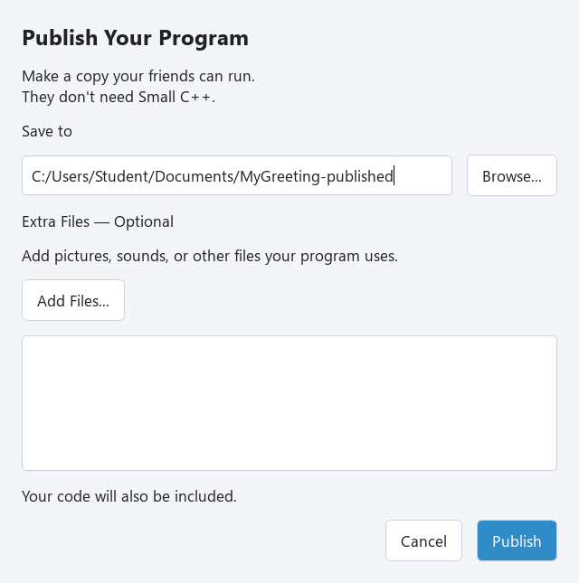
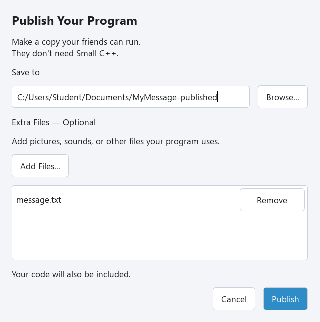
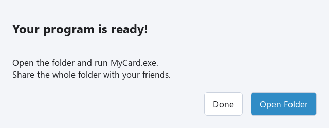

한 주제 안에서 차근차근 배워 봅니다. 예제를 하나씩 실행하고, 중간에 쉬었다가 이어서 해도 좋습니다. 마지막의 추가 연습은 원하는 만큼 해 보세요.

## 프로그램 배포본 만들기

### 친구에게 보여 줄 프로그램

@code example.cpp

**Try This Code**로 열고 **MyGreeting.cpp**로 저장한 뒤 **Run**을 누르세요. 마지막 input은 Enter를 누를 때까지 기다려서 인사말을 읽을 시간을 줍니다. 배포한 콘솔 프로그램은 할 일이 끝나면 닫힙니다. IDE에서 제공하는 자동 종료 대기는 배포본에 들어가지 않습니다.

### Windows 배포 폴더 만들기

1. **File → Publish…**를 선택하세요. **Publish Your Program** 창이 열립니다.
2. **Save to** 옆의 **Browse…**로 새 폴더를 만들 위치를 고르세요. MyGreeting-Published처럼 아직 없는 폴더 이름을 사용하세요.
3. 이 프로그램은 **Extra Files — Optional**을 비워 두고 **Publish**를 누르세요.
4. **Your program is ready!**가 나오면 **Open Folder**를 누르세요.
5. **MyGreeting.exe**를 더블 클릭하고 인사말을 읽은 뒤 Enter를 누르세요.

Publish는 내 컴퓨터에 Windows x64 배포본을 만듭니다. 인터넷에 올리는 기능은 아닙니다. 친구는 Small C++, Qt, 컴파일러를 설치하지 않아도 실행할 수 있습니다. 폴더에는 소스 코드도 들어가므로 친구가 어떻게 만들었는지 읽어 볼 수 있어요.

## 추가 파일 함께 넣기

### 프로그램이 읽는 파일

코드에서 파일 이름으로 불러오는 그림, 소리, 데이터는 별도의 파일입니다. Publish는 필요한 파일을 추측하지 않으므로 직접 골라 주세요.

@code extra_files_example.cpp

일반 텍스트 파일 **message.txt**를 만들고 Hello from a file!을 한 줄 적으세요. 저장한 MyMessage.cpp 옆에 두고 프로그램을 실행하세요. 텍스트 파일을 만드는 방법이 필요하면 작은 걸음 IV의 텍스트 파일 수업을 참고하세요. 이름이 message.txt.txt가 아닌 message.txt인지 확인하세요.

### 배포본에 파일 넣기

1. **File → Publish…**를 선택하고 새 대상 폴더를 정하세요.
2. **Extra Files — Optional**에서 **Add Files…**를 누르고 message.txt를 고르세요.
3. 목록을 확인하세요. 잘못 고른 파일은 **Remove**로 빼세요. **Add Files…**를 다시 눌러 더 추가할 수도 있습니다.
4. **Publish**, **Open Folder**를 차례로 누르세요. 폴더에 MyMessage.exe와 message.txt가 함께 있어야 합니다.
5. MyMessage.exe를 더블 클릭해서 파일에 적은 문장이 나오는지 확인하세요.

선택한 파일은 exe 옆에 복사됩니다. picture.png, music.wav처럼 간단한 영어 파일 이름을 쓰고 코드의 이름과 정확히 맞추세요. 현재는 같은 폴더에 놓는 파일을 지원하므로 하위 폴더 경로를 사용하지 마세요. 이름이 같은 파일 두 개를 동시에 넣을 수는 없습니다.

## 친구에게 보내기

### 작은 인사 카드 만들기

@code share_example.cpp

MyCard.cpp로 저장하세요. 실행해 본 뒤 새 폴더에 배포하세요. 앞 수업에서 완성한 다른 프로그램을 사용해도 좋습니다.

### 보내기 전에 확인하기

배포 폴더를 열고 MyCard.exe를 더블 클릭해서 결과를 확인하세요. 추가 파일을 쓰는 프로그램이라면 그것도 확인하세요. Publish가 만든 DLL 파일과 플러그인, licenses 폴더 등은 모두 함께 두세요. 원본 소스코드와 재링크 자료는 자동으로 포함되지 않습니다. 공유하려고 배포 파일들을 열거나 고칠 필요는 없습니다.

**exe만 보내지 말고 폴더 전체를 보내세요.** 나머지 파일은 실행에 필요하거나 라이브러리의 라이선스와 소스를 구하는 방법을 담고 있습니다. 그림과 소리 등은 내가 공유할 수 있는 자료만 넣으세요.

### ZIP으로 묶기

1. 실행 중인 프로그램을 닫으세요.
2. 파일 탐색기에서 배포 폴더의 상위 폴더로 이동하세요.
3. 배포 폴더 전체를 오른쪽 클릭하고 ZIP으로 압축하는 항목을 선택하세요. Windows 버전에 따라 **Compress to ZIP file** 또는 **Send to → Compressed (zipped) folder** 등으로 표시됩니다.
4. 평소 사용하는 파일 공유 방법으로 ZIP을 친구에게 보내세요. 일부 서비스는 ZIP 안에 있는 실행 파일도 막습니다. 학교나 가정에서 허용하는 공유 방법을 사용하세요.

친구는 ZIP을 저장하고 **Extract All…**에 해당하는 압축 풀기를 선택한 뒤, 풀린 폴더를 열어 exe를 더블 클릭하면 됩니다. ZIP 안에서 바로 실행하지 마세요. 배포본은 Windows x64용이며 휴대폰이나 Mac용은 아닙니다. 친구에게 Small C++ 설치는 필요하지 않습니다.

## Exercise — 나만의 인사말

친구에게 전할 말로 인사말을 바꾸세요. MyGreeting.cpp로 저장하고 새 폴더에 배포하세요. 새 MyGreeting.exe를 실행해서 바꾼 인사말이 나오는지 확인하세요.

@exercise exercise_starter.cpp

### Hint

print의 큰따옴표 안을 바꾸고 마지막 input은 남겨 두세요. Publish할 때마다 새 대상 폴더가 필요합니다. 기존 폴더를 덮어쓰지 않습니다.

@solution exercise_solution.cpp

## 더 해 보기 (선택)

## Exercise — 다른 메시지 읽기

소스 옆에 friend.txt를 만들고 새 메시지를 한 줄 적으세요. 프로그램이 friend.txt를 읽도록 바꾸고 저장하세요. Publish에서 friend.txt를 선택해 배포하고 배포 폴더의 exe를 실행하세요.

@exercise extra_files_exercise_starter.cpp

### Hint

file.open의 이름을 바꾸세요. 코드만 바꿔서는 파일이 복사되지 않습니다. Add Files에서도 friend.txt를 골라야 합니다. 그림과 소리를 불러오는 프로그램도 같은 방법으로 함께 넣습니다.

@solution extra_files_exercise_solution.cpp

## Exercise — 친구가 받을 파일 확인하기

아래 카드를 나만의 메시지로 바꾸고 배포하세요. ZIP으로 묶고 다른 폴더에 압축을 풀어 그 안의 exe를 실행하세요. 가능하면 다른 Windows x64 컴퓨터에서도 실행해 보세요. 이름과 메시지, 추가 파일이 모두 맞는지 확인한 뒤 보내세요.

@exercise share_exercise_starter.cpp

### Hint

print의 문자열을 바꾸세요. 카드를 읽을 수 있도록 input은 남겨 두세요. 아래 풀이는 카드의 한 예입니다. 중요한 것은 압축을 푼 배포본 전체가 잘 실행되는지 확인하는 것입니다.

@solution share_exercise_solution.cpp
