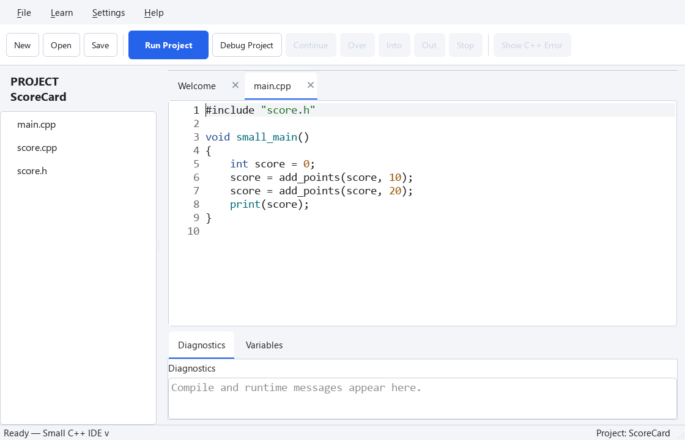

한 주제 안에서 차근차근 배워 봅니다. 예제를 하나씩 실행하고, 중간에 쉬었다가 이어서 해도 좋습니다. 마지막의 추가 연습은 원하는 만큼 해 보세요.

## 폴더 하나가 프로젝트

### 코드가 길어졌다면

한 파일로 충분하면 그대로 써도 됩니다. 함수가 많아져서 역할별로 나누고 싶을 때 프로젝트를 사용하세요. **폴더 하나가 프로젝트 하나**입니다.

### 첫 프로젝트 만들기

1. **File → New Project…**를 누릅니다.
2. 프로젝트를 둘 위치를 고르고 이름을 `Greeting`으로 입력합니다.
3. 만들어진 `main.cpp`의 내용을 아래 코드로 바꾸고 저장합니다.

@code example.cpp

**Run Project**를 누르면 `Hello, project!`가 나옵니다. 왼쪽 PROJECT 아래의 이름은 폴더 이름입니다. 창 제목과 아래 상태 표시줄에서도 프로젝트를 확인할 수 있습니다.

이미 폴더가 있다면 **File → Open Project (Folder)…**에서 그 폴더 안으로 들어간 뒤 **Open This Folder**를 누르세요. `small.project`가 없어도 열립니다.

### 탭과 프로젝트는 다릅니다

탭은 지금 읽고 고치는 파일입니다. Run Project는 선택한 탭 하나가 아니라 프로젝트의 모든 포함된 `.cpp`를 함께 사용합니다. 탭을 닫아도 파일은 프로젝트에 남습니다. 다른 폴더의 파일을 열면 탭에 **[Outside Project]**가 표시되고 프로젝트 실행에는 들어가지 않습니다.

**File → Close Project**는 프로젝트를 닫습니다. 파일을 삭제하지는 않습니다.

### 실제 폴더 확인하기

왼쪽 프로젝트 이름이나 파일 목록의 빈 공간을 우클릭하고 **Show Project in File Explorer**를 선택하세요. 프로젝트 폴더가 파일 탐색기로 열립니다. 파일이나 탭을 우클릭해 **Show in File Explorer**를 선택하면 그 파일을 선택해서 보여 줍니다. 아직 저장하지 않은 파일에서는 사용할 수 없습니다.

## 파일마다 역할 정하기

### 점수 계산을 분리하기

파일 이름은 역할을 설명하면 좋습니다. 새로운 `ScoreCard` 프로젝트를 만들고 `main.cpp`, `score.h`, `score.cpp`를 같은 폴더에 둡니다. 아래 코드로 각각 바꿔 보세요.

### score.h
```cpp
#pragma once

int add_points(int score, int points);
```

### score.cpp
```cpp
#include "score.h"

int add_points(int score, int points)
{
    return score + points;
}
```

### main.cpp
```cpp
#include "score.h"

void small_main()
{
    int score = 0;
    score = add_points(score, 10);
    score = add_points(score, 20);
    print(score);
}
```

**Run Project**를 누르면 `30`이 나옵니다. `main.cpp`는 프로그램의 흐름을 정하고, `score.cpp`는 점수 계산을 맡습니다. 점수는 main의 지역변수입니다. 함수에 값을 전달하고 새 값을 돌려받으므로 공유 전역변수가 필요 없습니다.

처음에는 **소스 파일과 같은 이름의 헤더**를 짝으로 만드세요. 필요한 함수 선언은 헤더에, 함수 정의는 소스에 둡니다. 한 파일로 충분한 작은 함수마다 파일을 만들 필요는 없습니다.

### 한 파일로 동작 확인하기



@code project_roles_example.cpp

## 연습 — 직접 확인하기

메시지를 바꾸고 저장하세요. 프로젝트를 닫았다가 같은 폴더를 다시 열어 실행해 보세요.

@exercise exercise_starter.cpp

### Hint

위에서 설명한 메뉴를 이용하세요. 아래 코드는 한 파일 연습의 답안입니다. 프로젝트에서는 해당 역할의 파일에 같은 변경을 적용하세요.

@solution exercise_solution.cpp

## 더 해 보기 (선택)

## 연습 — 직접 확인하기

한 파일 연습에 5점을 더하는 호출을 추가해 35를 출력하세요. 다음으로 프로젝트의 main.cpp에도 같은 호출을 추가하세요. score.h와 score.cpp는 바꿀 필요가 있을까요?

@exercise project_roles_exercise_starter.cpp

### Hint

위에서 설명한 메뉴를 이용하세요. 아래 코드는 한 파일 연습의 답안입니다. 프로젝트에서는 해당 역할의 파일에 같은 변경을 적용하세요.

@solution project_roles_exercise_solution.cpp
