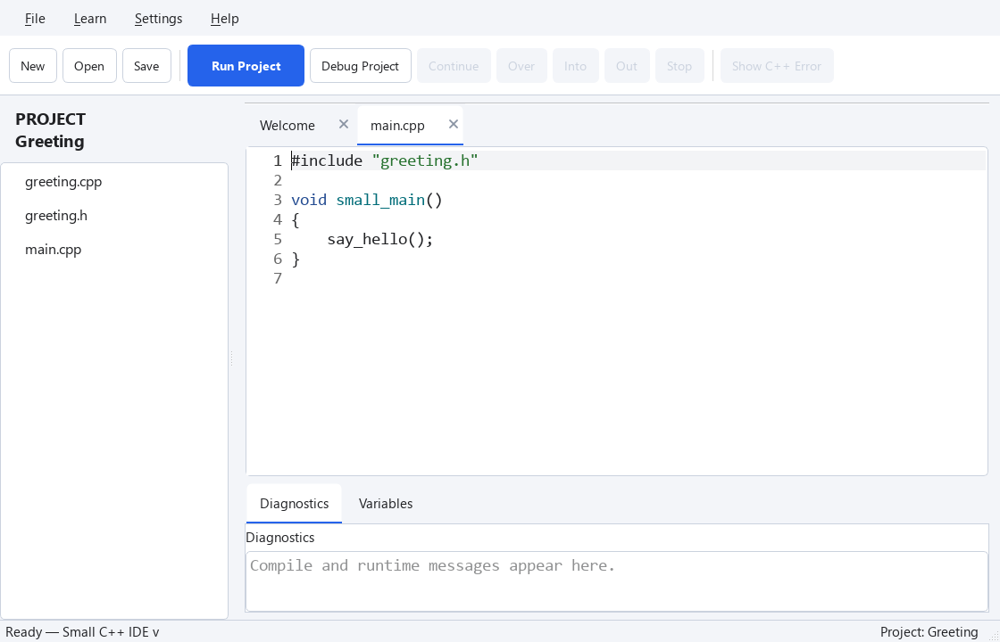

Explore one topic in small steps. Try the examples one at a time and take a break whenever you need. Choose how many extra exercises you want to try.

## Split a Program into Two Files

### Try it in one file first

@code example.cpp

We will move `say_hello` to another file. Continue in the `Greeting` project from the previous lesson.

### Create greeting.cpp

Right-click a blank area in the file list and choose **New Source File…**. Enter `greeting.cpp`. The new file opens in a tab. Put the following code in it.

### greeting.cpp
```cpp
void say_hello()
{
    print("Hello from another file!");
}
```

Replace `main.cpp` with the following. Remove the body of `say_hello` from this file and add its declaration at the top.

### main.cpp
```cpp
void say_hello();

void small_main()
{
    say_hello();
}
```

`void say_hello();`, ending with a semicolon, introduces the function. The version with braces supplies its body. Choose **Run Project**: the result is unchanged.

Keep only one `small_main` in the whole project. Do not `#include` a `.cpp` file. The IDE compiles each included `.cpp` separately and links them together.

## Give Functions a Header

### Keep introductions in one place

Previously we wrote a function declaration directly in `main.cpp`. A header keeps that introduction in one place when several files need it.

Right-click a blank area and choose **New Header File…** to create `greeting.h`. Keep the generated `#pragma once` line.

### greeting.h
```cpp
#pragma once

void say_hello();
```

### greeting.cpp
```cpp
#include "greeting.h"

void say_hello()
{
    print("Hello from another file!");
}
```

### main.cpp
```cpp
#include "greeting.h"

void small_main()
{
    say_hello();
}
```

`#include "greeting.h"` reads that header into the current file. Use double quotes for a header in the same folder. The function body exists only in `greeting.cpp`. That file includes its own header too, so the compiler can check that the declaration matches the definition.

`#pragma once` prevents repeated inclusion of a header during the compilation of one source file. It is not a C++ standard feature, but Small C++'s compiler supports it. You can learn the standard alternative, include guards, later.

### Check the same behavior in one file



The following combines the same program into one file. **Try This Code** opens this one-file version; it does not create the three project files automatically.

@code project_headers_example.cpp

## Exercise — Check it yourself

Change the greeting in the one-file practice below. Then make the same change in your project's greeting.cpp. Close the main.cpp tab and try Run Project again.

@exercise exercise_starter.cpp

### Hint

Use the menus described above. The solution below is for the one-file practice. Apply the same change to the file with that job in your project.

@solution exercise_solution.cpp

## Try More (Optional)

## Exercise — Check it yourself

Call say_hello twice in the one-file practice. Then get the same result in your project by changing only main.cpp.

@exercise project_headers_exercise_starter.cpp

### Hint

Use the menus described above. The solution below is for the one-file practice. Apply the same change to the file with that job in your project.

@solution project_headers_exercise_solution.cpp
